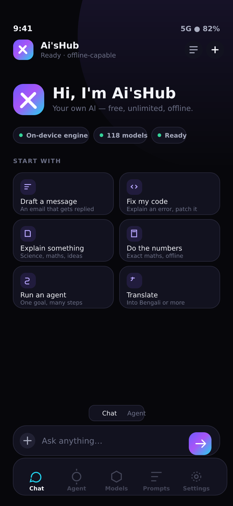
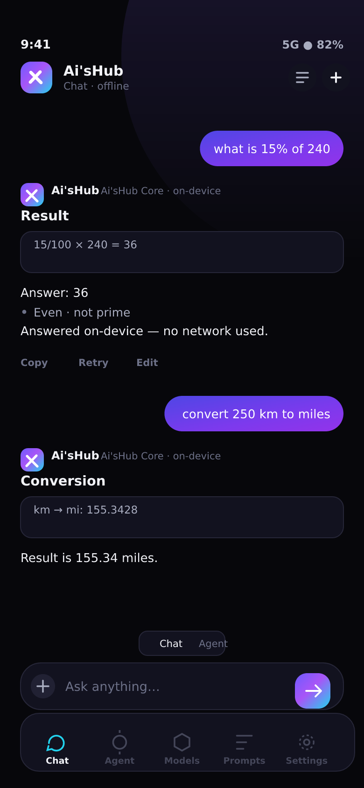
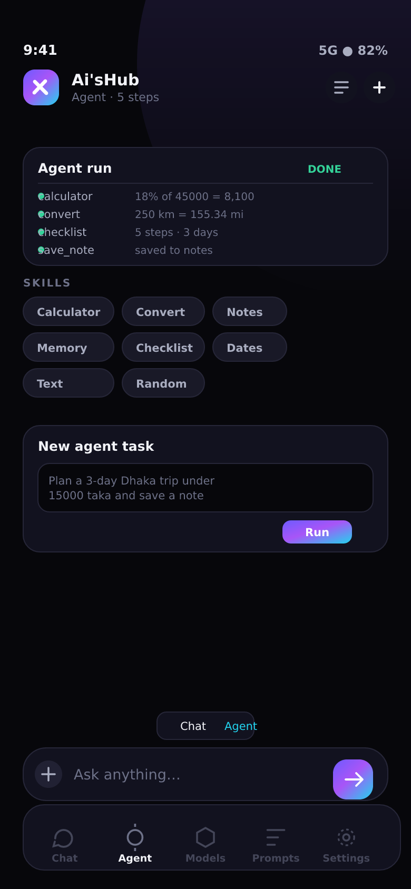
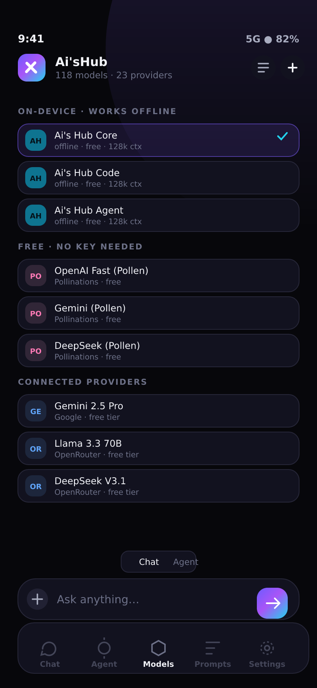
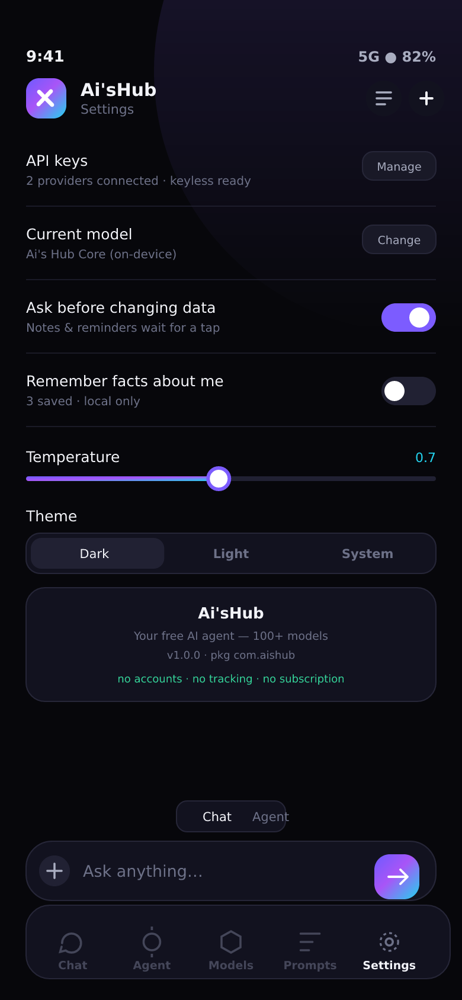

<div align="center">


# Ai'sHub

**Your own AI agent — free, unlimited, and it works offline.**

Chat + agent mode · 118 models across 23 providers · new models add themselves
Android app (`com.aishub`) · installable PWA · no account, no subscription, no tracking

[](#tests)
[](#the-model-catalog)
[](#offline-mode)
[](#build-the-android-apk)





</div>

---

## What this is

Ai'sHub is a complete mobile AI app you own. Three engines sit under one interface, and the app
picks the best one that is actually available:

| Layer | Needs | Gives you |
| --- | --- | --- |
| **On-device engine** | nothing — no network, no key, no account | instant answers for maths, units, text, plans, code structure and a 48-topic knowledge base |
| **Keyless free models** | just internet | cloud-quality answers from Pollinations with zero signup |
| **Your own free keys** | a free key from Gemini / Groq / OpenRouter / … | 118 models, including Claude, GPT, Gemini, Llama, Qwen, DeepSeek, Kimi, GLM |

If a cloud call fails (rate limit, dead key, offline), the app silently walks down a fallback
ladder — same provider → keyless free → any connected provider → **on-device engine** — and tells you
which brain answered. You never get a dead end.

## Feature tour

**Chat mode**
- Streaming answers with clean Markdown: headings, tables, lists, fenced code with copy buttons.
- Copy / retry / edit / delete-from-here on every reply; token count and latency shown.
- Image attachments go to vision models; text and code files are read straight into the prompt.
- Works fully offline — the local engine answers without a single network request.

**Agent mode**
- Give one goal; the agent plans, then runs real skills: calculator, unit converter, notes, memory,
  date maths, text tools, checklists, random picker, offline knowledge, web fetch, JSON APIs, reminders.
- Every step is visible in a live trace; each run is saved in the **Agent** tab with its full output.
- Steps that change data ask for a tap first (configurable), and a hard step limit keeps things sane.
- Saved notes automatically capture the finished report — not an empty draft.

**Models tab**
- 118 curated models over 23 providers, grouped as *on-device → free/keyless → connected → add-a-key*.
- Filter by free / offline / vision / tools, search by model or provider name.
- **Sync** pulls each provider's live `/models` list, merges brand-new IDs into the catalog, badges them
  **NEW** and toasts you. Runs automatically on launch, on reconnect, and every 6 hours.
- Any OpenAI-compatible endpoint can be added by hand (custom model, base URL, key).

**Prompts & Assistants**
- 10 ready-made assistants (Senior Engineer, Study Tutor, Writing Coach, Translator, Data Analyst,
  Founder Copilot, Wellness Guide, Trip Planner, Agent Operator…) that set the system prompt, the
  model and the mode in one tap.
- A 16-card prompt library for the things people actually do daily.

**Settings**
- Provider keys (stored only on the device, sent straight to the provider), key test, base-URL overrides.
- Temperature, max tokens, streaming, auto-sync, theme (dark/light/system), language (English/বাংলা).
- Agent approval mode and step limit, memory on/off, custom instructions, haptics.
- Memory and notes managers, JSON export/import, clear chats, full reset.

## The model catalog

23 providers ship pre-wired, all through one OpenAI-compatible client:

| Provider | Free tier | How Ai'sHub uses it |
| --- | --- | --- |
| **Ai'sHub Local** | unlimited, offline | 5 on-device personas (core, code, writer, tutor, agent) |
| **Pollinations** | free, **no key** | works the second you install |
| **OpenRouter** | models ending `:free` | 24 presets + whatever your key can see |
| **Google Gemini** | generous free tier | 7 presets, 1M-token context |
| **Groq** | ~30 req/min free | 9 presets, very fast |
| Cerebras · Mistral · NVIDIA NIM · GitHub Models · Together · DeepSeek · xAI · Fireworks · Hyperbolic · SambaNova · Cohere · Perplexity · Moonshot · Z.ai GLM · Cloudflare Workers AI | varying free tiers | 40+ presets, one key each |
| Ollama · LM Studio · llama.cpp | your own hardware | point the app at your PC or LAN server |

Provider logos are initials on purpose: no third-party trademarks are bundled, and the list stays
current through discovery rather than hard-coded branding.

## Offline mode

The on-device engine (`src/js/offline/`) is not a fake "offline banner" — it really answers:

1. **Intent classifier** — question, maths, conversion, code, writing, plan, translate, decide, joke…
2. **Local tools** — a shunting-yard maths evaluator (no `eval`), exact unit tables (length, mass,
   volume, time, data, speed, temperature), text statistics, case/slug transforms, date maths,
   CSPRNG random picker and password generator.
3. **Knowledge base** — 48 full Markdown topics (science, maths, coding, writing, health, money,
   travel, first aid…) with a stemmed retrieval index.
4. **Composition** — structured answers with headings, tables, checklists and code, streamed with
   natural pacing so it feels like a model.

It is honest about its limits: when a question needs frontier reasoning it says so and offers a
one-tap handoff to a cloud model. Everything else — chats, notes, memories, agent logs, settings —
is stored locally (IndexedDB + localStorage) and keeps working with the network off.

## Install

### 1 · Install the app (PWA, 10 seconds)
Open the published page, then use **Install app** / **Add to Home Screen**. It installs with the
Ai'sHub icon, opens full-screen, and the shell is cached by a service worker so it launches offline.

### 2 · Build the Android app (APK, package `com.aishub`)

```bash
npm install
npm run sync            # builds docs++dist++ and copies the web app into android/
cd android
./gradlew assembleDebug # -> app/build/outputs/apk/debug/app-debug.apk
```

Or open the `android/` folder in Android Studio and press Run. Requirements: JDK 17+ and the
Android SDK (API 36). **The app needs Android 7.0 or newer** (`minSdk 24`): the Capacitor 8
stack refuses anything lower, so an older phone will report "App not installed".

If the app ever fails to start it says so on screen instead of going blank: a plain-ES5 guard
catches script errors, and a native panel reports the boot stage, the build revision and the
Android/WebView versions, with Copy and Reload buttons. The web app is bundled inside the APK, so the installed app is offline-first
with no server and no Play Store dependency.

`npm run android` does the sync and the Gradle build in one step.

### 3 · Build your own APK with the included workflow
`.github/workflows/android.yml` builds debug **and** release APKs, uploads them as artifacts and
attaches them to a `builds` release. It needs GitHub Actions enabled on the repository
(Settings → Actions → Allow all actions). `.github/workflows/pages.yml` publishes the PWA to GitHub
Pages from `docs/` the same way.

## Phone control

Chat with Ai'sHub and ask it to do something on the phone. It recognises the request, calls a
native Android plugin (`PhoneControl`), does the thing, and writes a plain answer back into the
chat — no menus, no buttons to hunt for.

| What you can say | What happens | Permission it may ask for once |
| --- | --- | --- |
| "wake me at 6:30 am" · "set a timer for 10 minutes" | real system alarm / timer | alarms |
| "what's on my calendar tomorrow" · "add a meeting at 3 pm" | reads / creates calendar events | calendar |
| "call Ammu" · "text Rahim that I'm late" | opens the dialer / SMS composer pre-filled | contacts, phone, SMS |
| "open YouTube" · "what apps do I have" | launches an app / lists installed apps | none (query only) |
| "turn on the torch" · "set volume to 30" · "make the screen brighter" | flashlight, media volume, brightness | camera torch, settings |
| "vibrate" · "copy this to my clipboard" | haptics, clipboard | none |
| "battery" · "storage" · "open Wi-Fi settings" | device status, jumps to the right settings panel | none |
| "read this screen" · "tap Search" · "type hello" | reads the screen, taps by label, types into a field | **accessibility service** |

Enable the accessibility service only if you want Ai'sHub to touch the screen for you:
Android **Settings → Accessibility → Installed apps / Downloaded apps → "Ai'sHub control" → On**.
Until you do, everything in the last row answers with one honest sentence instead of pretending.

### What it does not do

No app can be "exactly like a cloud assistant" on a phone, and it would be dishonest to claim it.
Ai'sHub has **no on-device language model** — the APK ships no weights and no runtime, so the brain
is the keyless cloud model (internet) or the built-in offline engine (no internet). Phone actions are
**one action per request, started by you, confirmed on screen**; there is no silent background
automation, no root, and Wi-Fi/Bluetooth toggles can only open their settings pages on modern
Android. It is free forever with no account, which is exactly what keeps it from being a paid
service with its own servers.

## Repository layout

```
src/                 the app source (plain ES5-compatible modules, no build step needed)
  css/               design tokens, layout, chat, screens
  js/core/           util, storage (IndexedDB + localStorage), events/settings, networking
  js/models/         catalog (118 models / 23 providers) + auto discovery
  js/offline/        knowledge base, on-device engine, skills (agent toolbelt)
  js/providers/      OpenAI-compatible client + unified client with fallback ladder
  js/chat/           markdown renderer, chat store, chat controller
  js/agent/          planner + runner
  js/ui/             components + the five screens
tools/               build (inlines everything), icons, previews, dev server
docs/                built, self-contained web app (this is what Pages serves)
android/             Capacitor 8 native project, package com.aishub
tests/               jsdom test suite (21 checks) that drives the built artifact
```

`npm run build` inlines every stylesheet and script into a single `docs/index.html` (~330 kB,
no CDN, no bundler, no framework) and writes a content-hashed service worker. That is why the app
works from `file://`, from a static host, and inside Capacitor with no CORS surprises.

## Commands

```bash
npm run build     # rebuild docs/ + dist/
npm run serve     # preview at http://localhost:4173
npm test          # build, then run the jsdom suite (21 tests)
npm run sync      # build + copy assets into the android project
npm run android   # sync + assemble a debug APK
npm run icons     # regenerate every icon/splash from the SVG logo
node tools/make-previews.mjs   # regenerate the README previews
```

## Tests

`npm test` boots the real built app in jsdom and asserts behaviour, not just functions:

```
ok 1  boots with the full app surface
ok 2  catalog exposes 100+ models across 20+ providers
ok 3  offline math engine is exact
ok 4  unit conversion covers length, mass, temperature and data
ok 5  intent classification routes the main request types
ok 6  offline replies answer real questions with content
ok 7  knowledge base retrieves and handles plurals
ok 8  markdown renderer escapes HTML and renders structure
ok 9  skills run locally: calculator, convert, text, notes, memory
ok 10 agent plans and executes a multi-step goal offline
ok 11 agent saves the finished report into a note (deferred step)
ok 12 storage degrades gracefully without IndexedDB
ok 13 model readiness explains missing keys and offline state
ok 14 fallback ladder ends on the on-device engine
ok 15 UI screens render and navigation works
ok 16 sending a message streams an answer into the chat
ok 17 deleting from a message removes it and everything after
ok 18 discovered models merge into the live catalog
ok 19 vision models receive image parts, text-only models get a notice
ok 20 reset drops discovered rows but keeps every preset
ok 21 provider key storage round-trips and never leaves the device
# pass 21   # fail 0
```

## Privacy

- **No Ai'sHub server exists.** There is no backend to send anything to.
- Keys, chats, notes, memories and agent logs live in this app's local storage on your device.
- Cloud prompts go directly from your phone to the provider you selected, with your key.
- No analytics, no ads, no telemetry, no fingerprinting.
- Reset everything from **Settings → Reset**.

Practical hygiene: don't paste passwords or card numbers into cloud models; switch to an
on-device model for text you want to keep local.

## Honest limits

- The on-device engine is fast, private and unlimited, but it is **not a frontier model**. Deep
  reasoning, niche facts and full-quality translation need a cloud model.
- Free cloud tiers have rate limits. The app surfaces them and offers another model instead of
  pretending the call worked.
- Provider model IDs change. Discovery + manual custom models cover that, but a preset can go stale.
- Google's free Gemini tier may use free-tier prompts to improve their products — their rule, not ours.

## Roadmap

- [ ] On-device neural model (WebLLM/GGUF) as an optional download for true local generation
- [ ] Share-sheet target so other apps can send text into Ai'sHub
- [ ] Encrypted backup passphrase for the JSON export
- [ ] Tool-calling passthrough for cloud models that support native function calls
- [ ] Bengali UI strings completed end-to-end

<div align="center">

**Ai'sHub** · built for one person: you. Free forever, unlimited, no sign-up.




</div>
